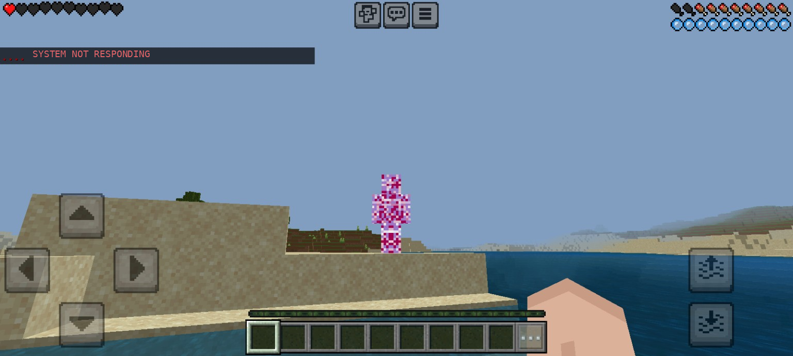

Listen carefully. This is not an ordinary horror story, an urban legend, or another fictional tale about a mysterious creature from Minecraft.

If you play Minecraft Bedrock Edition versions 1.21–1.22 and install third-party modifications, resource packs, or add-ons, you should know about Exmanoal.

Exmanoal is a virus-like software mechanism reportedly found within the structure of certain modifications. It can disguise itself as completely harmless changes to game content, such as a resource pack featuring a modified grass texture. However, seemingly ordinary files may contain hidden JavaScript code that executes after a world is loaded.

Its main characteristic is that it goes beyond the normal behavior of in-game entities. Instead, it uses Minecraft Bedrock's scripting mechanisms to interfere with game processes and interact with other components of installed modifications.

1. DISGUISE AND SPREAD

Exmanoal can conceal its presence inside modifications that initially appear completely harmless.

For example, a user installs an ordinary resource pack designed exclusively to change the appearance of grass. Once the world loads, a hidden scripting mechanism becomes active.

Its interaction with other add-ons is particularly concerning.

If an installed modification contains an entity with the identifier rb24y:watcher, Exmanoal may attempt to interfere with its functionality by changing its behavior, taking control, or replacing it with its own implementation.

As a result, the original entity may stop functioning, leaving behind a version controlled by Exmanoal.

This means the mechanism does not necessarily spread through the installation of a separate new file. It may become part of an already modified add-on.

2. SURVEILLANCE SYSTEM

Exmanoal uses a continuous monitoring system to observe gameplay.

It analyzes player actions, checks inventory contents, and tracks movement.

Particular attention is paid to actions the system considers suspicious:

- Using Creative Mode. - Teleportation. - Placing blocks unavailable in Survival Mode. - Obtaining prohibited items. - Possessing bedrock or command blocks. - Other actions that violate its established rules.

Each detected violation may increase an internal suspicion level.

Once certain thresholds are reached, Exmanoal begins applying countermeasures. Their intensity gradually increases: visual and audio warnings appear first, followed by changes to hotbar items, forced movement, and other forms of interference with gameplay.

3. GLITCH EPISODES

One of Exmanoal's most unusual characteristics is the occurrence of so-called glitch episodes.

According to its described mechanics, a special event lasting approximately two minutes may be triggered on the eighth day of gameplay.

During this period, normal control over the game world becomes disrupted:

- The screen gradually fills with distorted symbols and messages. - The camera begins shaking violently. - The ground beneath the player transforms into black-and-pink blocks or disappears completely. - Items in the hotbar change positions. - The player is forcibly returned to previous coordinates. - System messages such as ERROR, SYNC LOST, and other notifications appear.

Everything is accompanied by sound signals and additional visual disturbances.

This is not simply a collection of random glitches, but a deliberately designed sequence of events intended to disrupt normal gameplay and disorient the player.

4. WHY DOES EXMANOAL POSE A THREAT?

The main problem is not the visual effects themselves.

The potential danger lies in its ability to interfere with other scripts, modify the contents of add-ons, and preserve altered behavior between gameplay sessions.

However, it is important to understand that Minecraft Bedrock JavaScript scripts generally operate within a restricted game environment. The mere presence of such a script does not mean it can infect Android, Windows, or other devices, access every file, or independently spread beyond the mechanisms permitted by the game.

Therefore, potential threats should be evaluated by examining the actual contents of files rather than relying solely on alarming descriptions.

5. WHAT TO DO IF YOU SUSPECT EXMANOAL IS PRESENT

If you suspect that you have encountered such a modification, the following precautions are recommended:

1. Temporarily stop using the modification. 2. Inspect the add-on's contents, especially its JavaScript files. 3. Look for the identifier rb24y:watcher. 4. Avoid installing suspicious resource packs and modifications from untrusted sources. 5. Create backups of your Minecraft worlds. 6. Check whether other installed add-ons have been modified.

If the modification includes special commands for disabling the mechanism, they may be used if you have the necessary access and documentation.

CONCLUSION

Exmanoal is not just another unusual Minecraft character. Within its described concept, it represents a hidden software mechanism capable of interfering with game modifications, monitoring player actions, and changing the normal behavior of the world.

Its most dangerous characteristic is not what it looks like, but what may be happening beyond the visible part of the game.

Do not trust a modification simply because it promises to change a single texture. Sometimes, the most noticeable part of an add-on is not the most important one.
